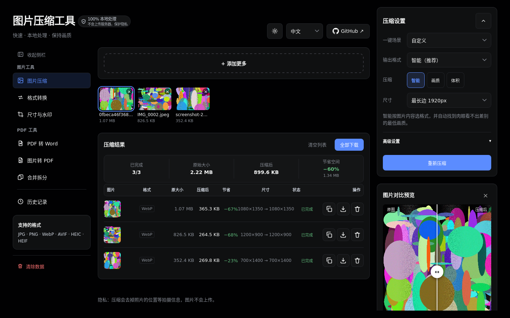
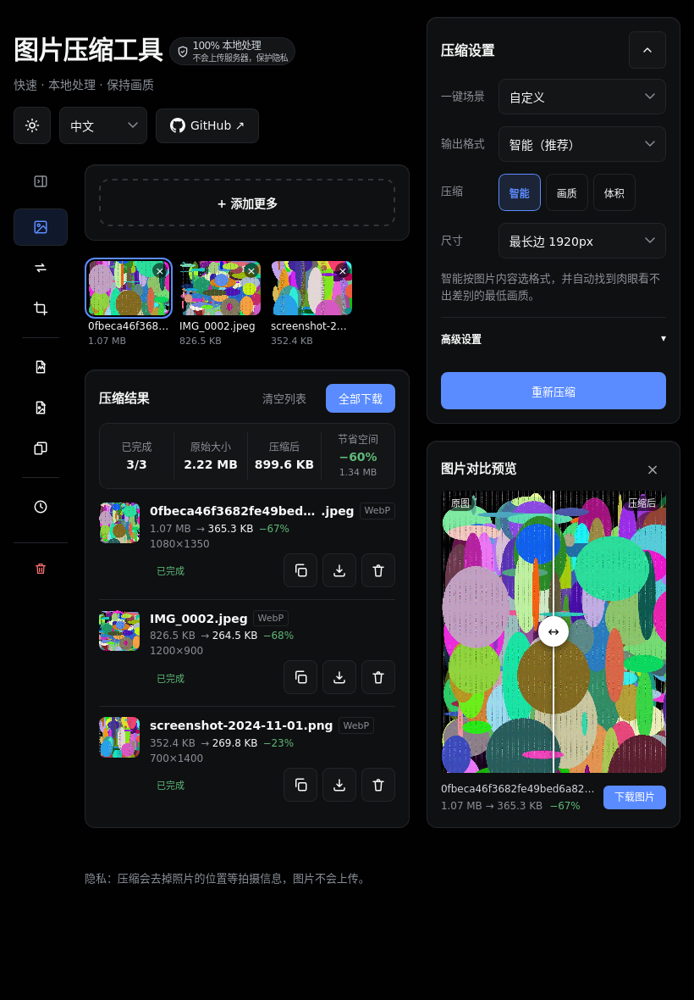
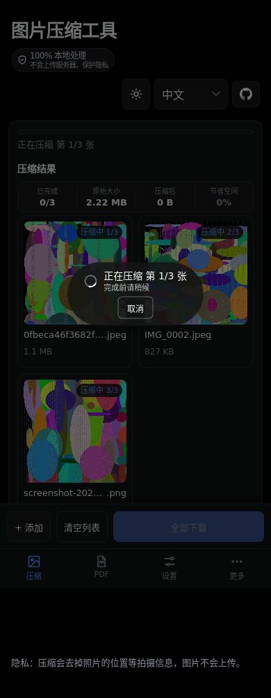

# Image Compressor

**Compress, convert, resize and turn images into PDFs — entirely in your browser.**
Nothing is uploaded. Works offline. Free and open source.

**English** · [简体中文](README.zh-CN.md)

### [Open the app →](https://kimorix.github.io/image-compressor/)

## Why

Most online image tools upload your photos to someone else's server. This one doesn't. Every file is decoded, processed and saved on your own device, so it is fast, private, and keeps working with no connection.

## Features

### Image tools

- **Compress** — Smart mode picks the format and the lowest quality that still looks like the original. Or compress by quality, or to a target file size (200 KB, 500 KB, 1 MB…). Batch hundreds of images, drop whole folders, paste from the clipboard.
- **Convert** — Between 10 output formats, from 15+ input formats including iPhone HEIC, RAW camera files, Photoshop PSD and JPEG XL.
- **Resize & watermark** — Long edge, exact size, percentage or social-media presets (Instagram, Xiaohongshu, TikTok, YouTube, ID photos…). Text or logo watermarks with live preview, drag to place, tile mode.
- **Ready-made scenes** — One tap for WeChat, articles, ID photos, websites or email attachments.

### PDF tools

- **PDF to Word** — Editable text with headings, lists and tables, or a pixel-faithful layout. Optional OCR for scanned pages.
- **Merge & split** — Drag pages across files, rotate, reorder, undo, keep bookmarks and forms, split by range or every N pages.
- **Images to PDF** — Photos, receipts and scans into one PDF or one per image, on A4, Letter or the image's own size.

### Everywhere

- 🔒 **Private by design** — Files never leave your device. Location data is stripped from photos by default.
- 📴 **Offline & installable** — Install it as an app; it keeps working without a network.
- 📱 **Phone, tablet and desktop** — A layout tuned for each, including iPad portrait and landscape, with a collapsible sidebar.
- 🔢 **Clear progress** — Every batch shows exactly which image it is on: "Compressing 3 / 19".
- 🧹 **Clear all local data** — One button wipes history, settings, caches and offline files.
- 🌗 **Light and dark themes**, following your system.
- 🌍 **6 languages** — English, 简体中文, 日本語, 한국어, Français, Deutsch.

## Screenshots

| Desktop | iPad | Phone |
| :---: | :---: | :---: |
|  |  |  |

## Supported formats

| | Formats |
| --- | --- |
| **Open** | JPEG, PNG, WebP, AVIF, HEIC / HEIF, GIF (first frame), BMP, TIFF, SVG, ICO, JPEG XL, PSD, QOI, TGA, camera RAW (DNG, CR2, CR3, NEF, ARW, ORF, RW2, RAF and more) |
| **Save as** | JPEG, PNG, WebP, AVIF, JPEG XL, GIF, BMP, TIFF, ICO, QOI |
| **PDF** | PDF → Word (.docx), PDF merge / split, images → PDF |

## Privacy

- All processing happens on your device. No uploads, no accounts, no tracking of your files.
- Photos lose GPS and other capture metadata unless you choose to keep it.
- History and settings stay in your browser. **Clear all local data** removes everything in one go.
- The only things downloaded on demand are the app's own encoders and, if you turn on OCR, its language data.

## Known limitations

- Animated GIFs keep only the first frame.
- JPEG XL output is limited to about 18 megapixels per image; use AVIF or WebP for larger photos.
- Images over 50 MB or 80 megapixels are skipped to protect memory.
- PDFs that need a password to open aren't supported yet in merge / split.
- PDF to Word can't rebuild complex tables, formulas or vertical text, though the text itself is kept.

## Contributing

Issues and pull requests are welcome. Please open an issue first for larger changes. Contributor and automation notes live in [AGENTS.md](AGENTS.md).

## License

[MIT](LICENSE) © 2026 kimorix
