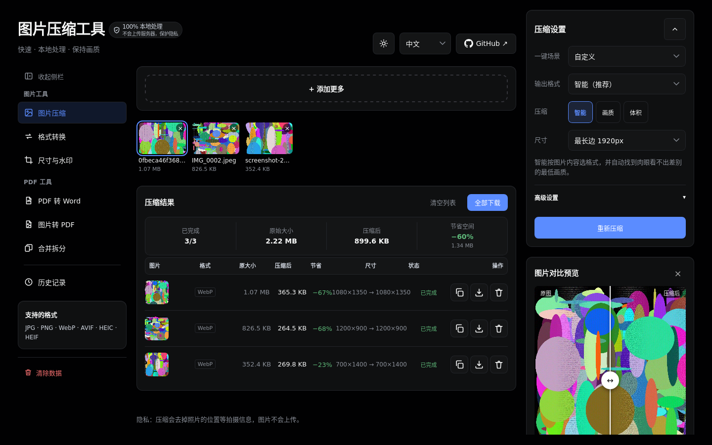
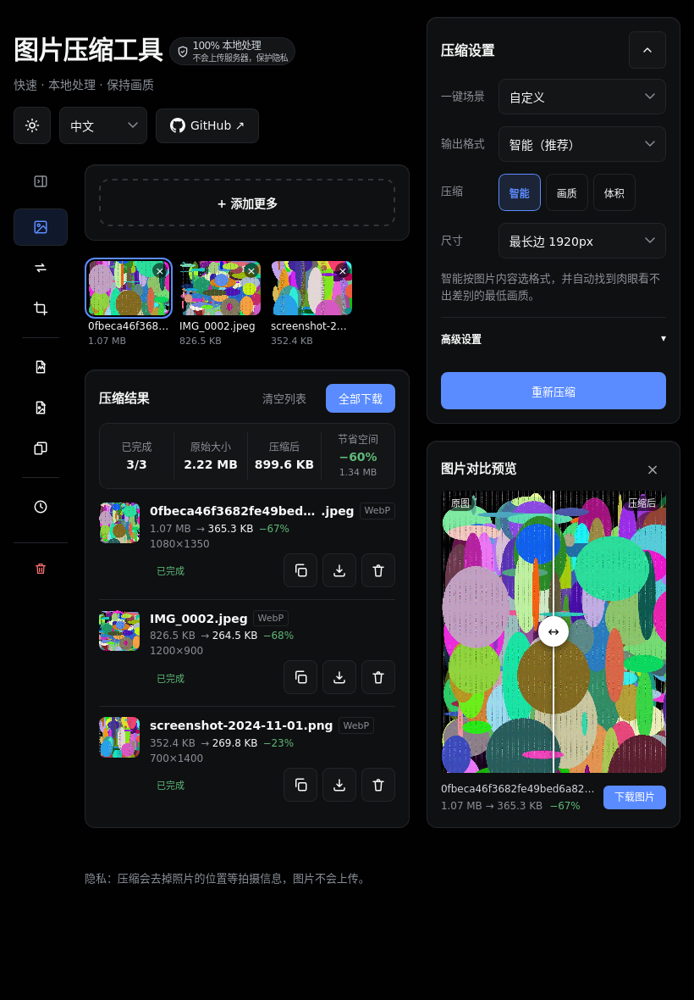
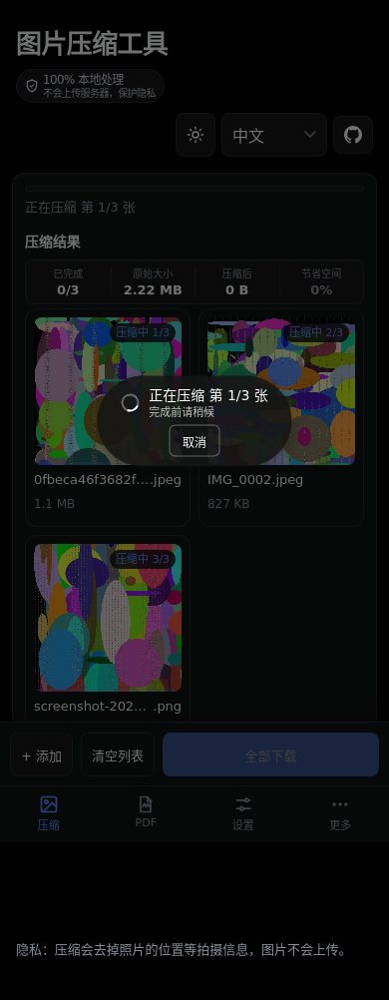

# 图片压缩 Image Compressor

**在浏览器里压缩、转换、改尺寸、生成 PDF —— 全部在本地完成。**
不上传任何文件，断网可用，免费开源。

[English](README.md) · **简体中文**

### [立即使用 →](https://kimorix.github.io/image-compressor/)

## 为什么做这个

大多数在线图片工具都会把你的照片传到别人的服务器上。这个不会。每个文件都在你自己的设备上解码、处理和保存，所以更快、更私密，没有网络也能用。

## 功能

### 图片工具

- **压缩** —— 智能模式自动选格式，并找到与原图看起来一致的最低画质；也可以按画质压缩，或压到指定体积（200 KB、500 KB、1 MB……）。支持批量、拖入整个文件夹、Ctrl+V 粘贴。
- **格式转换** —— 15 种以上输入格式（含 iPhone HEIC、相机 RAW、Photoshop PSD、JPEG XL），10 种输出格式。
- **尺寸与水印** —— 按长边、指定宽高、百分比或社媒预设（小红书、抖音、公众号、Instagram、YouTube、证件照等）改尺寸；文字或 Logo 水印，实时预览、拖动定位、平铺。
- **常用场景** —— 微信发图、公众号配图、证件照、网站/博客、邮件附件，一键套用。

### PDF 工具

- **PDF 转 Word** —— 可编辑模式还原标题、列表、表格；保留版式模式与原 PDF 一致。扫描件可选 OCR 识别。
- **合并拆分** —— 跨文件拖动页面、旋转、排序、撤销，保留书签和表单；按范围或每 N 页拆分。
- **图片转 PDF** —— 照片、收据、扫描件合成一个 PDF 或每张一个，支持 A4、Letter 或按图片尺寸。

### 处处用心

- 🔒 **隐私优先** —— 文件从不离开你的设备，照片默认去除位置信息。
- 📴 **离线可用、可安装** —— 像 App 一样安装到桌面或主屏幕，断网照常使用。
- 📱 **手机、iPad、电脑** —— 针对每种屏幕单独调过布局，包括 iPad 横竖屏，侧栏可收起为图标栏。
- 🔢 **进度一目了然** —— 批量处理时显示当前序号，例如「正在压缩 第 3/19 张」。
- 🧹 **一键清除本地数据** —— 历史记录、设置、缓存和离线文件一次删干净。
- 🌗 **浅色 / 深色主题**，默认跟随系统。
- 🌍 **6 种语言** —— 简体中文、English、日本語、한국어、Français、Deutsch。

## 截图

| 电脑 | iPad | 手机 |
| :---: | :---: | :---: |
|  |  |  |

## 支持的格式

| | 格式 |
| --- | --- |
| **可打开** | JPEG、PNG、WebP、AVIF、HEIC / HEIF、GIF（首帧）、BMP、TIFF、SVG、ICO、JPEG XL、PSD、QOI、TGA、相机 RAW（DNG、CR2、CR3、NEF、ARW、ORF、RW2、RAF 等） |
| **可保存为** | JPEG、PNG、WebP、AVIF、JPEG XL、GIF、BMP、TIFF、ICO、QOI |
| **PDF** | PDF 转 Word（.docx）、PDF 合并 / 拆分、图片转 PDF |

## 隐私

- 所有处理都在你的设备上完成：不上传、不需要账号、不追踪你的文件。
- 照片默认去掉 GPS 等拍摄信息，除非你选择保留。
- 历史和设置只保存在浏览器里，「清除本地数据」可一次全部删除。
- 唯一按需下载的是应用自带的编码器；开启 OCR 时还会下载识别语言数据。

## 已知限制

- GIF 动图只保留第一帧。
- JPEG XL 输出单张约 1800 万像素以内，更大的照片请选 AVIF 或 WebP。
- 超过 50 MB 或 8000 万像素的图片会被跳过，以免内存不足。
- 合并拆分暂不支持需要打开密码的 PDF。
- PDF 转 Word 无法还原复杂表格、公式和竖排文字（文字本身会保留）。

## 参与贡献

欢迎提 Issue 和 Pull Request；较大的改动请先开 Issue 讨论。开发与自动化说明见 [AGENTS.md](AGENTS.md)。

## 许可证

[MIT](LICENSE) © 2026 kimorix
